# Lacold

<p>
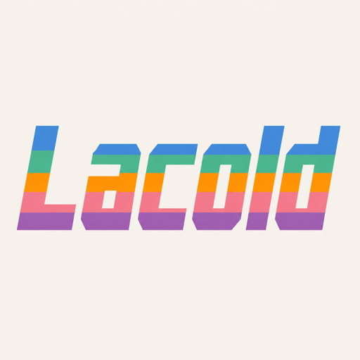
Lacold is an ink-first theme family for editors, terminals, and developer tools.
Neutral colors carry most text and interface hierarchy, restrained accents add
structure, and a fixed semantic palette keeps feedback clear.<br><br>
The theme family includes Blue, Green, Orange, Pink, Purple, and Rainbow in
independent Light and Dark palettes: twelve variants in total.
</p>

<br clear="left">

## Preview

<p align="center">
<picture>
    <source media="(prefers-color-scheme: dark)"
            srcset="assets/screenshots/dark-air-blue.png">
    <source media="(prefers-color-scheme: light)"
            srcset="assets/screenshots/light-air-blue.png">
    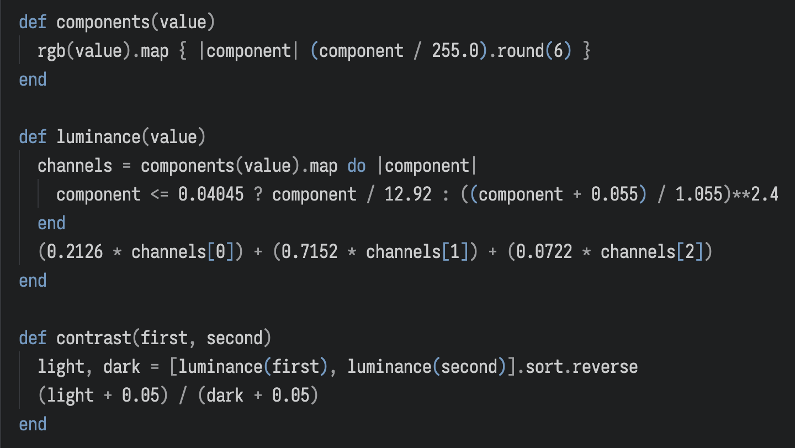
</picture>
</p>

<p align="center">
<em>Lacold Blue — the preview follows your GitHub appearance.</em>
</p>

<details>
<summary><strong>View all variants</strong></summary>

<br>

<table>
<thead>
    <tr>
    <th>Accent</th>
    <th>Light</th>
    <th>Dark</th>
    </tr>
</thead>
<tbody>
    <tr>
    <th>Blue</th>
    <td>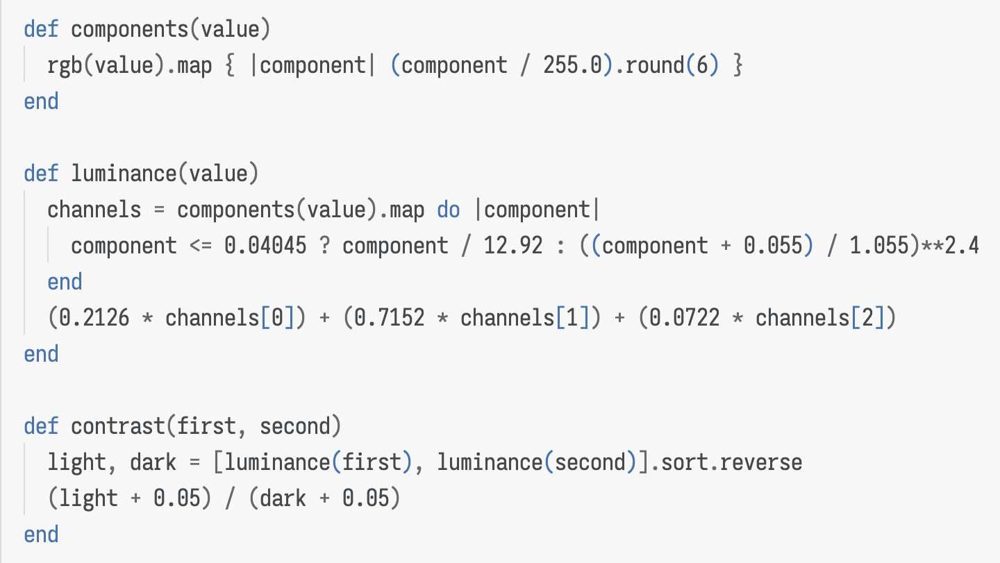</td>
    <td></td>
    </tr>
    <tr>
    <th>Green</th>
    <td>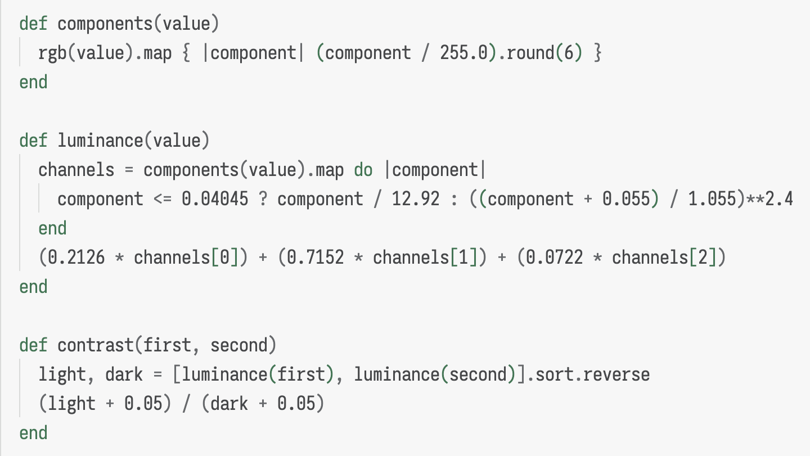</td>
    <td>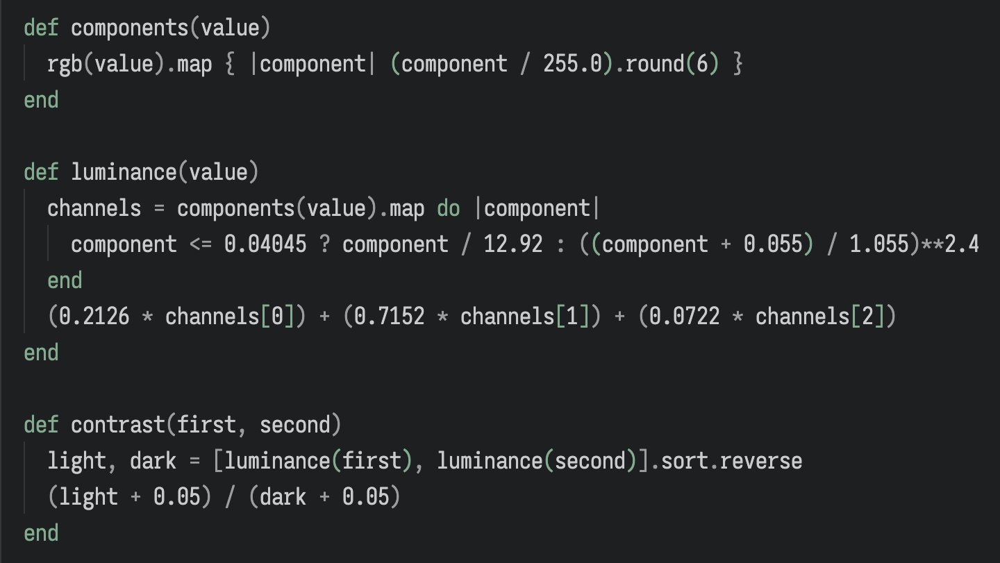</td>
    </tr>
    <tr>
    <th>Orange</th>
    <td>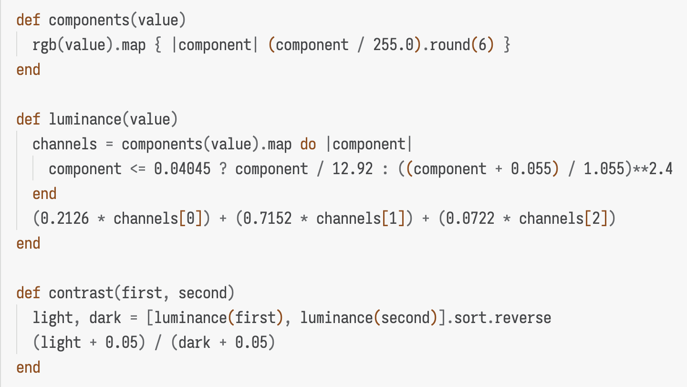</td>
    <td>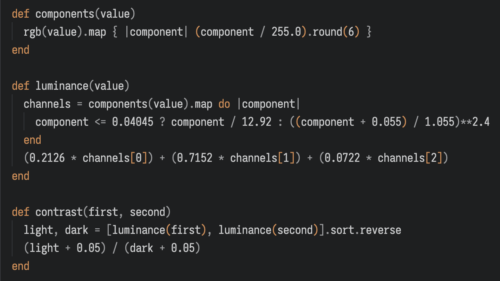</td>
    </tr>
    <tr>
    <th>Pink</th>
    <td>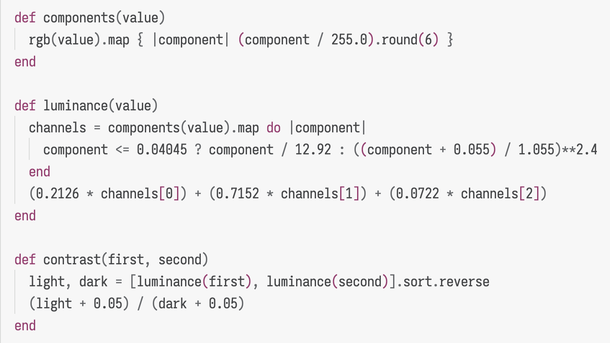</td>
    <td>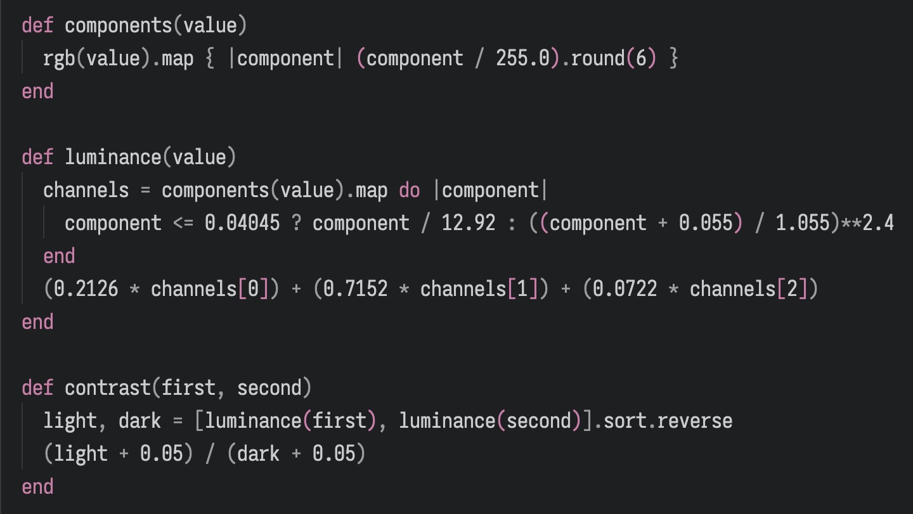</td>
    </tr>
    <tr>
    <th>Purple</th>
    <td>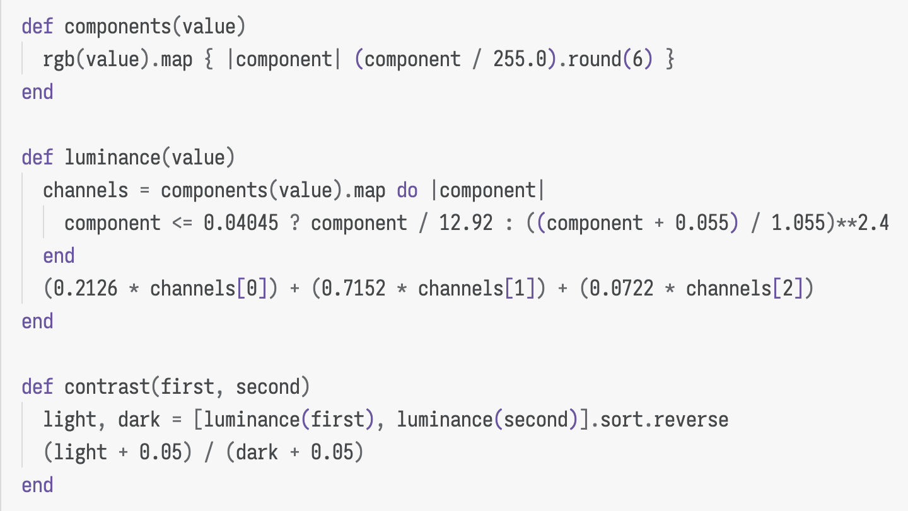</td>
    <td>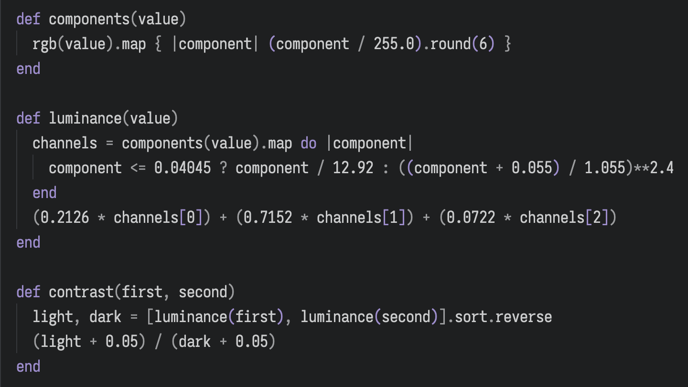</td>
    </tr>
    <tr>
    <th>Rainbow</th>
    <td>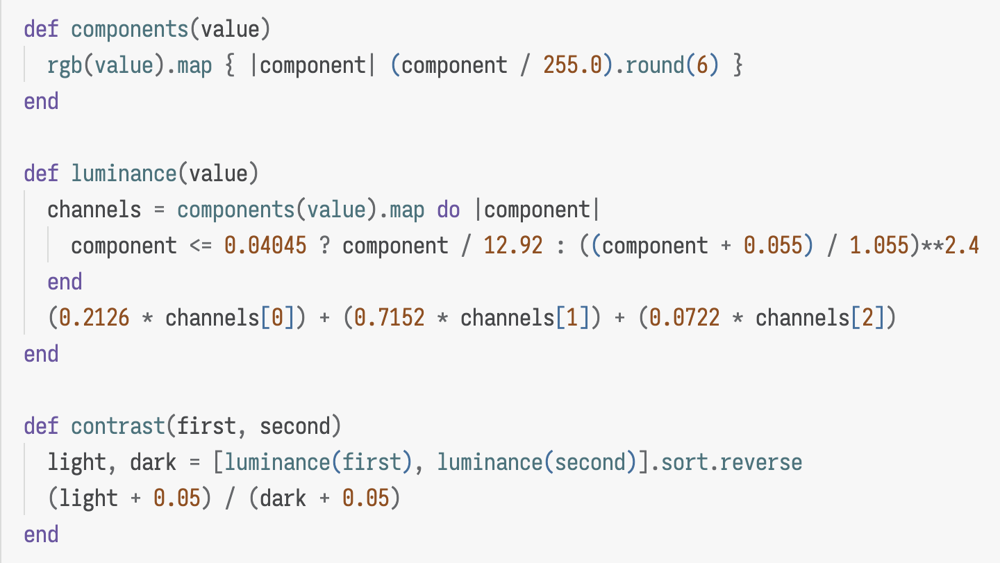</td>
    <td>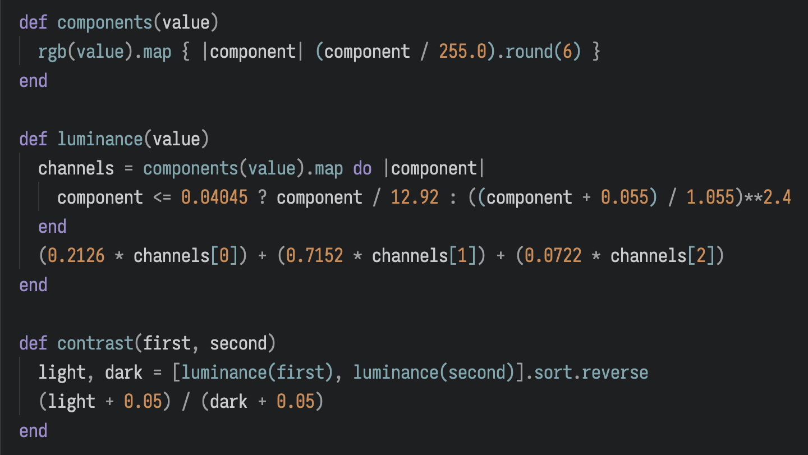</td>
    </tr>
</tbody>
</table>

</details>

## Usage

Editors: [VS Code](targets/vscode/README.md) ·
[Visual Studio](targets/visual-studio/README.md) ·
[Vim/NeoVim](targets/vim/README.md) · [Emacs](targets/emacs/README.md) ·
[IntelliJ](targets/intellij/README.md) · [Zed](targets/zed/README.md) ·
[Xcode](targets/xcode/README.md) · [CotEditor](targets/coteditor/README.md) ·
[Kate](targets/kate/README.md) · [Gedit](targets/gedit/README.md) ·
[DrRacket](targets/dr-racket/README.md)

Terminals: [Terminal.app](targets/terminal-app/README.md) ·
[iTerm2](targets/iterm2/README.md) ·
[GNOME Terminal](targets/gnome-terminal/README.md) ·
[Windows Terminal](targets/windows-terminal/README.md) ·
[Konsole](targets/konsole/README.md) · [Kitty](targets/kitty/README.md)

CLI tools: [Fish](targets/fish/README.md) · [Tmux](targets/tmux/README.md) ·
[Zellij](targets/zellij/README.md) · [bat](targets/bat/README.md) ·
[fzf](targets/fzf/README.md) · [Nano](targets/nano/README.md) ·
[BTop](targets/btop/README.md) · [Codex CLI](targets/codex/README.md) ·
[OpenCode](targets/opencode/README.md) · [Agy](targets/agy/README.md)

Fish, Vim/NeoVim, OpenCode, and iTerm2 produce adaptive Light/Dark artifacts
when both modes are selected. Kitty also produces automatic-appearance bundles.

## Shell command

`lacold` is a sourceable shell function, with entry points for
[Fish](lacold.fish), [Bash](lacold.bash), and [Zsh](lacold.zsh). Keep this checkout
available and source the matching file from your shell configuration
(Ruby 3.2+ is required):

```fish
# ~/.config/fish/config.fish
source "/path/to/lacold-theme/lacold.fish"
```

```sh
# ~/.bashrc
source "/path/to/lacold-theme/lacold.bash"

# ~/.zshrc
source "/path/to/lacold-theme/lacold.zsh"
```

The functions reuse the Ruby generator in this checkout; no new executable,
package installation, or daemon is needed. The existing `bin/lacold` remains
the developer build command.

```sh
lacold list                              # all 27 targets, files, configured colors
lacold show kitty                        # palette roles, hex values, references
lacold variants
lacold install kitty --color blue --mode auto
lacold install fish --color orange --mode auto
lacold install fzf --color orange --mode auto
lacold use kitty pink auto
lacold set kitty bg '#202124' --mode dark
lacold set all accent_primary '#88AACC'   # all managed items, both appearances
lacold set vim syntax_keyword '#B09BDD'
lacold reset kitty bg
lacold reload all
lacold remove kitty
lacold migrate --dry-run
lacold migrate                           # remove legacy Lacold Air names
```

`install` writes native files and configures selection for Fish, Kitty, Vim,
Emacs, Codex, fzf, bat, Tmux, Nano, BTop, Zellij, Zed, OpenCode and VS Code.
For an existing recognizable Lacold selection, installation keeps its color
and mode unless you specify options. `install all` includes every target;
targets requiring application-specific import have their artifacts and native
instructions staged in the local theme library. Xcode, CotEditor, Gedit, Kate
and Konsole receive theme files but still require selection in the app.
System permissions can prevent writes to an application's theme directory.

`use`, `set`, `reset`, `reload`, and `remove` operate on managed items. First
run `install ITEM` to adopt an existing installation. `all` for these commands
means all managed items. `list` also reports unmanaged installations and reads
recognizable selections from explicitly named config files. It cannot inspect
the live selection inside every running GUI app. For unmanaged items, `show`
labels generated palette previews separately from installed file references.

Color overrides stay local and regenerate both explicit Light/Dark files and
adaptive family files. `show` lists role names such as `bg`, `fg`,
`accent_primary`, `semantic_red`, and `syntax_keyword`. Quote hex colors so
shells do not interpret `#` as a comment. These functions do not write overrides
back into the repository's authored palettes.

Fish, fzf, and bat update in the invoking shell; bat's theme cache is rebuilt
when available. Fish appearance notifications update fzf and bat automatically.
Fish, Kitty, Vim, iTerm2, and OpenCode have native adaptive artifacts. Other apps
need their usual reload/restart or import, as reported by `list`. In Bash/Zsh,
set `LACOLD_APPEARANCE=light` or `dark` before `lacold reload all` to choose the
fallback for targets without native adaptive support; the default is dark.

State, generated files, and original-file backups live under
`${XDG_STATE_HOME:-~/.local/state}/lacold/`; set `LACOLD_STATE_HOME` to override
this location. XDG config/data directories, `CODEX_HOME`, and `BAT_CONFIG_DIR`
are respected. State/backups are private files. A failed multi-item operation
restores file contents; removal restores originals and leaves files with
external edits untouched by aborting before changes. If a managed file was
edited outside Lacold, reconcile it with the original backup before retrying.
Empty directories can remain after removal.

Migration only visits known theme directories and explicitly named startup or
settings files. It backs up old files/references, detects filename collisions,
and removes stale Emacs bytecode instead of rewriting compiled bytes. It does
not search your home directory. App-managed imported profile databases are
outside its scope. Originals are retained in the private state's `migrations`
map; migration is separate from theme removal.

## Design

Lacold keeps ordinary syntax neutral and uses authored accents for structure,
navigation, and selection. Diagnostics, diffs, search, and terminal ANSI colors
use consistent semantic roles across every variant.

Rainbow keeps the interface on a calm blue-cyan axis while its syntax uses seven
chromatic lanes plus neutral ink and gray.

## Development

Lacold requires Ruby 3.2 or newer and has no runtime gem dependencies.

```sh
bundle install
bundle exec rake check
bundle exec rake build
bundle exec rake site
```

Generated themes are written to `dist/`. Use `--output` to choose another
directory.

For a focused build, use the CLI directly:

```sh
bin/lacold list
bin/lacold build --target vim,kitty --color pink --mode dark
```

`rake check` validates palettes, contrast, generated output, manifest
completeness, and deterministic builds. The static demo is built into `_site/`.

Version tags such as `v0.1.0` create release archives, checksums, and a VSIX.
Publishing to Visual Studio Marketplace and Open VSX is enabled when the
corresponding repository credentials are configured.

## License

[MIT](LICENSE)
